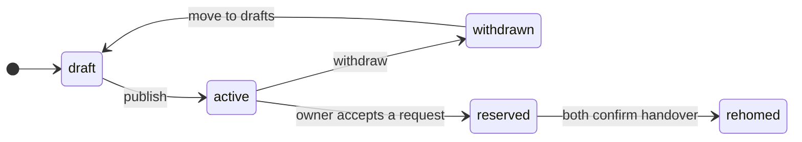
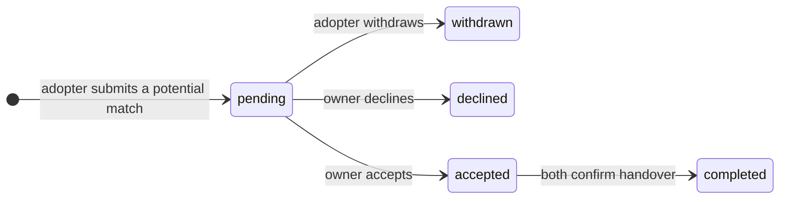
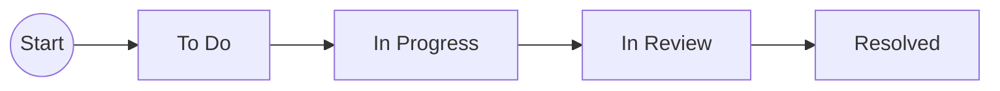

<p align="center">
  
</p>

<h1 align="center">AquaBridge</h1>

<p align="center">
  <b>Responsible rehoming for aquatic animals and plants.</b><br>
  CS2701 Group Project · Brunel University London · Group B14, Start-up 1 · UN SDG 14 Life Below Water
</p>

<p align="center">
  <a href="https://aquabridge-zeta.vercel.app"><b>Live site</b></a> ·
  <a href="https://aquabridge-zeta.vercel.app/prototype/">Prototype</a> ·
  <a href="https://aquabridge-zeta.vercel.app/prototype/demos">Demo flows</a> ·
  <a href="https://aquabridge-zeta.vercel.app/backlog/">Sprint 1 backlog</a> ·
  <a href="https://aquabridge-zeta.vercel.app/prototype/design">Design system</a> ·
  <a href="https://dsouzashawn305.atlassian.net/jira/software/projects/KAN/boards/1">Jira (KAN)</a>
</p>

---

> [!NOTE]
> This repository holds the **Sprint 1 front end**: a React + Vite + Tailwind app with sample data, guided demo flows and the detailed backlog. It started as the clickable design prototype and is now the codebase the team builds on. Guidance and compatibility results are illustrative examples, **not** legal or biological advice.

## Contents

- [What AquaBridge does](#what-aquabridge-does)
- [Quick start](#quick-start)
- [What’s in this repo](#whats-in-this-repo)
- [Tech stack and development](#tech-stack-and-development)
- [Using the prototype](#using-the-prototype)
- [Demo flows](#demo-flows)
- [Design system](#design-system)
- [Shared data contracts](#shared-data-contracts)
- [Team and ownership](#team-and-ownership)
- [Jira workflow](#jira-workflow)
- [Updating the backlog](#updating-the-backlog)
- [Deploying to Vercel](#deploying-to-vercel)

---

## What AquaBridge does

Owners who can no longer care for fish, shrimp or aquatic plants get guided towards a responsible new home instead of releasing them. Adopters check that their tank or pond is suitable before they ask. Nothing is bought or sold.


---

## Quick start

| Option | How |
|---|---|
| **Live site** | **https://aquabridge-zeta.vercel.app** (updates automatically on every push to `main`) |
| Run the app locally | `cd app` → `npm install` → `npm run dev`, then open http://localhost:5173 |
| Original static prototype | Open `static-prototype/index.html` in a browser (kept for comparison) |

> [!TIP]
> Sample data and your clicks are saved in your browser. Use **Reset sample data** in the prototype footer to start fresh.

---

## What’s in this repo

```text
.
├── index.html                  Team hub: links to everything below
├── app/                        The React app (deployed at /prototype/) — see "Tech stack and development"
├── static-prototype/
│   └── index.html              The original single-file prototype, kept for side-by-side comparison
├── backlog/
│   └── index.html              Sprint 1 backlog page (generated, filter by person and week)
├── planning/
│   ├── sprint1-tasks.json      Source of truth: stories, epics, tickets, acceptance criteria
│   ├── backlog.template.html   Template for the backlog page
│   └── sprint1-jira-import.csv Jira CSV import (generated)
├── tools/
│   ├── build.js                Rebuilds backlog/index.html and the CSV from the JSON
│   └── build-site.js           Builds the whole Vercel site into dist/ (run by Vercel)
├── vercel.json                 Vercel build settings and the /prototype/ page rewrite
└── docs/assets/                Aquarium illustration and colour swatches used in this README
```

---

## Tech stack and development

| Layer | Choice | Notes |
|---|---|---|
| Framework | **React 19 + Vite** | `app/` · fast dev server, static build |
| Language | **JavaScript** | Shared data shapes are documented with JSDoc in `src/services/contracts.js` |
| Styling | **Tailwind CSS v4** | Design tokens live in `@theme` in `src/index.css` (`bg-primary`, `text-ink-2`, `rounded-ab` …) |
| Routing | **React Router** | Real URLs per screen; signed-out users are sent to login and back (`RequireAuth`) |
| State | React context + `localStorage` | `src/services/store.jsx`: `update(s => …)` changes a copy, saves and re-renders. Saved data is versioned (`DATA_VERSION`): bump it when the sample data changes |
| Tests | **Vitest + React Testing Library + axe-core** | `npm test` runs unit, journey and automated accessibility tests |
| Quality | ESLint + Prettier (with the Tailwind class sorter) | `npm run lint` · `npm run format` |

```bash
cd app
npm install      # first time only
npm run dev      # http://localhost:5173
npm test         # 52 tests: rules, request service, sign-in, journeys, accessibility (axe-core) on 26 pages
npm run lint
npm run build    # production build into app/dist
```

### Where the code lives

```text
app/src/
├── index.css            Tailwind + design tokens (the only place colours are defined)
├── routes.js            Every screen: URL, owner, Sprint 1 tasks and stories (drives the build notes and screen map)
├── App.jsx              Route table
├── shared/              Midhir · SH-02/SH-09 components (Button, Chip, Field, Notice, Plate, Tracker), Layout, hooks
├── services/            Shared · contracts, species catalogue, sample data, RequestService, store (mock auth)
├── features/
│   ├── home/            Homepage
│   ├── listings/        Shawn · browse, listing page, editor, My Listings, incoming requests
│   ├── guidance/        Farhan · questionnaire, review, guidance rules, care widget
│   ├── habitat/         Midhir · My Habitat, compatibility rules and page, request form, My Requests
│   └── auth/            Sign-in checkpoint (replaced by the university login later)
└── reference/           Prototype-only: demo flows engine, screen map, design system page
```

### Rules of thumb

- **Use the tokens.** `bg-primary`, `text-ink`, `border-line`, `rounded-ab`. Tailwind's default colour palette is switched off on purpose, so `bg-teal-600` won't work.
- **Reuse `shared/` components** instead of repeating long class lists. If a pattern appears twice, make it a component.
- **Change state only through `update()` or `run()`** from `useStore()`, and request state only through `services/requestService.js`.
- **Read species only through `getSpecies` / `listSpecies`** (`services/species.js`).
- Work mostly inside your own `features/` folder to avoid merge conflicts.
- Link with `<Link to>` or `Button to`, never a raw `href="/…"`: the live site runs under `/prototype/`, and router links add that automatically.
- A crash on one screen shows a friendly error page (`shared/ErrorBoundary.jsx`) instead of a blank page.

---

## Using the prototype

### The pages

| Area | Screens | Login needed |
|---|---|---|
| **Public** | Homepage · Browse listings · Listing details · Species guide · Rehoming questions · Check your answers · Guidance | No |
| **Rehoming** (account menu) | My Listings · Listing editor · Incoming requests | Yes |
| **Adopting** (account menu) | My Habitat · Compatibility check · Request adoption · My Requests | Yes |
| **Team tools** (footer) | Demo flows · Screen map · Design system | No |

### Things to know

| Feature | What it does |
|---|---|
| **Sample user** | Any login signs in as **Jordan Lee (U-01)**, who owns some listings and has sent some requests, so both sides of the product can be seen. |
| **Return after login** | Starting a guarded action while signed out (e.g. *Create my listing*) asks you to log in, then returns you to that action with your answers kept. |
| **Screen info bar** | The bar under the header names each screen’s builder, Sprint 1 tickets and stories, with a **Screen details** link to its page in the team reference. Hide it from the bar; bring it back from the footer. |
| **Team reference** | `/prototype/team`: overview, demo flows, a screen map with a page per screen (purpose, contents, tickets with acceptance criteria, stories, demo steps) and the design system with code to copy. Linked from the footer only. |
| **Demo controls** | Dashed amber boxes let you play the *other* person (e.g. “Owner accepts”). They exist only in the prototype. |
| **Reset sample data** | Footer link. Restores every listing, habitat and request. |
| **Direct links** | Every screen has its own address, e.g. `/prototype/browse`, `/prototype/listings/L-1045`, `/prototype/team/demos`. Old `#demos`-style links still redirect. |

### Sample outcomes to try

| To see… | Do this |
|---|---|
| Eligible guidance | Rehome → Animal → **Neon tetra** → Healthy |
| Needs review | Rehome → Animal → **I’m not sure what it is** |
| Restricted | Rehome → Animal → **Red-eared slider** |
| Potential match | Neon tetras listing → Check compatibility → **Living room tropical tank** |
| Needs information | Java fern listing → **Bedroom nano tank** (pH missing) |
| Blocked | Pink hardy water lily → **Living room tropical tank** (pond only) |

---

## Demo flows

Open **Demo flows** from the prototype footer (or `/prototype/team/demos`). Each flow starts from fresh sample data. A guide panel says **who is acting**, **what they do**, **what the system does** and **who builds it**. Press **Next step** and the prototype performs the action and highlights it. **Back** works at every step. Every screen page in the team reference has **Play from here** buttons that start a flow at that screen.

### Flow 1 · Owner · Rehome six neon tetras (11 steps)

An owner who is moving answers the rehoming questions, can list them, signs in and publishes a listing that is already filled in.

| # | Step | Actor | Built by |
|---|---|---|---|
| 1 | Start from the homepage | Owner, signed out | Shared homepage · Farhan coordinates routes |
| 2 | Animal or plant? | Owner, signed out | Farhan · F-01, F-02 |
| 3 | Which species, and how many? | Owner, signed out | Farhan · F-02, F-05 |
| 4 | How is it doing? | Owner, signed out | Farhan · F-02 |
| 5 | Where, and how soon? | Owner, signed out | Farhan · F-02 |
| 6 | Check your answers | Owner, signed out | Farhan · F-03 |
| 7 | Read the guidance | Owner, signed out | Farhan · F-04 |
| 8 | Sign in only when it matters | Owner, signed out | Shared · Farhan coordinates sign-in |
| 9 | The listing is already filled in | Owner, signed in | Farhan F-06 → Shawn S-01 |
| 10 | Published to My listings | Owner, signed in | Shawn · S-01, S-04, S-05 |
| 11 | Visible to adopters | Anyone | Shawn · S-02 |

### Flow 2 · Adopter · Check a tank and ask to adopt Java ferns (11 steps)

A returning adopter signs in at the compatibility check, sees all three possible results, fixes a missing detail and sends a request.

| # | Step | Actor | Built by |
|---|---|---|---|
| 1 | Browse without an account | Adopter, signed out | Shawn · S-02 |
| 2 | Open a listing | Adopter, signed out | Shawn S-03 + Farhan F-05 |
| 3 | Sign in to use a saved tank | Adopter, signed out | Shared · sign-in |
| 4 | Result: more details needed | Adopter, signed in | Midhir · M-03, M-04 |
| 5 | For comparison: not compatible | Adopter, signed in | Midhir · M-04 |
| 6 | Add the missing detail | Adopter, signed in | Midhir · M-01, M-02 |
| 7 | Result: looks suitable | Adopter, signed in | Midhir · M-03, M-04 |
| 8 | Write the request | Adopter, signed in | Midhir M-06 → Shawn S-08 |
| 9 | Request sent | Adopter, signed in | Midhir · M-06 |
| 10 | Follow it in My adoption requests | Adopter, signed in | Midhir · M-07 |
| 11 | The owner accepts | Owner → adopter | Shawn S-07 → Midhir M-07 |

### Flow 3 · Owner and adopter · Choose an adopter and complete the handover (11 steps)

The owner compares two requests and accepts one. Both sides confirm the handover, and the listing is marked rehomed.

| # | Step | Actor | Built by |
|---|---|---|---|
| 1 | Two requests arrive | Owner | Shawn · S-06 |
| 2 | Compare their tanks | Owner | Midhir M-05 → Shawn S-06 |
| 3 | Decide | Owner | Shawn · S-07 |
| 4 | Accepted and reserved | Owner | Shawn · S-07, S-08 |
| 5 | The other request is put on hold | Owner | Shawn · S-08 |
| 6 | My listings | Owner | Shawn · S-04, S-05 |
| 7 | Owner confirms the handover | Owner | Shawn · S-07 |
| 8 | The adopter’s side | Adopter | Midhir · M-09 |
| 9 | Both confirmed: rehomed | System | Shawn · S-07, S-08 |
| 10 | Gone from Browse listings | Anyone | Shawn · S-02 |
| 11 | Kept in the owner’s history | Owner | Shawn · S-04 |

### Flow 4 · New adopter · Create an account and add a first tank (10 steps)

Someone new to AquaBridge creates an account at the compatibility check, adds their first tank from scratch, fills a gap and asks to adopt.

| # | Step | Actor | Built by |
|---|---|---|---|
| 1 | Find something to adopt | New adopter, signed out | Shawn · S-03 |
| 2 | Create an account | New adopter, signed out | Shared · REG-001, REG-005 |
| 3 | No tank saved yet | New adopter, signed in | Midhir · M-03 |
| 4 | Add the first tank | New adopter, signed in | Midhir · M-01 |
| 5 | Some details are missing | New adopter, signed in | Midhir · M-02, M-04 |
| 6 | Fill the gaps | New adopter, signed in | Midhir · M-01 |
| 7 | Looks suitable | New adopter, signed in | Midhir · M-04 |
| 8 | Ask to adopt | New adopter, signed in | Midhir M-06 → Shawn S-08 |
| 9 | Request sent | New adopter, signed in | Midhir · M-06 |
| 10 | The tank is saved for next time | New adopter, signed in | Midhir · M-02 |

### Flow 5 · Owner · Restricted species and animals that need checking (7 steps)

What an owner sees when a listing is not allowed: a restricted species, then an animal that is unwell. Both get clear next steps instead of an error.

| # | Step | Actor | Built by |
|---|---|---|---|
| 1 | A restricted species | Owner, signed out | Farhan · F-02, F-05 |
| 2 | It can’t be listed | Owner, signed out | Farhan · F-04 |
| 3 | What to do instead | Owner, signed out | Farhan · F-04, GUID-006 |
| 4 | Look it up in the species guide | Owner, signed out | Farhan · F-08 |
| 5 | An animal that is unwell | Owner, signed out | Farhan · F-02 |
| 6 | Needs checking first | Owner, signed out | Farhan · F-04, GUID-005 |
| 7 | Never release them | Anyone | Shared · SDG 14 |

---

## Design system

Calm, plain and trustworthy, in the style of a public service rather than a startup landing page. One typeface, one accent colour, borders only where they separate something. See [`docs/design-audit.md`](docs/design-audit.md) for the audit behind it, and the live **Design system** page in the prototype footer.

### Colours

Tokens live in `app/src/index.css` (`@theme`). Tailwind's default palette is switched off, so use these names.

| | Name | Hex | Token | Use |
|---|---|---|---|---|
|  | Ink | `#13293D` | `ink` | Headings and body text |
|  | Secondary text | `#4B5F6B` | `ink-2` | Hints, captions, metadata |
|  | Teal | `#0A6B60` | `primary` | The one accent: primary buttons and links |
|  | Teal tint | `#E3F1EE` | `primary-soft` | Selected rows, information insets |
|  | White | `#FFFFFF` | `surface` | Page background |
|  | Mist | `#F5F7F7` | `mist` | Section backgrounds and quiet panels |
|  | Line | `#D4DCDC` | `line` | Dividers and table rules |
|  | Field border | `#8A9A9E` | `line-strong` | Form fields (3:1 contrast) |
|  | Success | `#1D6E46` | `ok` | Live, completed, potential match |
|  | Caution | `#8A5300` | `warn` | Waiting for owner, reserved, needs information |
|  | Error | `#B02A22` | `bad` | Errors, declined, not compatible, restricted |

### Type

**Atkinson Hyperlegible Next** for everything, weights 400 to 700. It was designed by the Braille Institute for readers with low vision. Hierarchy comes from size and weight only: no second display font, no monospace, no uppercase labels.

Scale: `14 · 16 · 18 · 22 · 28 · 36 · 48 px` · Body `17px / 1.5` · Corners `4px` (buttons, fields, tags) and `8px` (cards, images)

### Components (`app/src/shared`)

| Component | Notes |
|---|---|
| Button | Primary (teal), secondary (grey), quiet (text link), danger (red). One primary per screen. Label says what happens: *Publish listing*, *Send request* |
| Tag (`Chip`) | Rectangular, sentence case, people's wording ("Waiting for owner"), never clickable, never colour alone |
| Field, Choice, Check | Label, hint, error, then the control. Required by default; optional fields say "(optional)". Large radios instead of choice cards |
| Error summary | "There is a problem" box at the top after a failed submit; takes focus and links to each field |
| Notice, Warning, Panel | Inset with a coloured left edge; "!" warning text; green confirmation panel with a reference |
| Species illustrations | One per species, in the style of the homepage aquarium, used until owners can upload photos |
| Summary list (`kv`) | Label/value rows with dividers for listing facts, habitats and care needs |
| Handover progress | Vertical checklist: accepted → owner confirmed → adopter confirmed → complete |
| Prototype banner | Says it is a prototype with sample data; "Team notes" shows the screen owner, tasks and stories |

### Rules we follow

| ✅ Do | ❌ Don’t |
|---|---|
| Let headings do the work; use a caption only to show position ("Step 2 of 4") | Small uppercase labels above every heading |
| Use people's words: tank, request to adopt, waiting for owner | Show record IDs (except a reference on a confirmation page) |
| Group with space and quiet tints | Borders on every card, boxes inside boxes, hover lifts |
| One primary button per screen | A filled button plus an outlined button everywhere |
| Error summary plus a message by the field saying how to fix it | Red asterisks, "invalid", clearing what someone typed |
| Tags with words | Coloured dots or colour alone |
| Dark focus outline, 44px targets, one column under 900px | Hover-only controls |

---

## Shared data contracts

| Entity | ID prefix | Owner |
|---|---|---|
| Species | `SP-` | Farhan |
| Intake (questionnaire outcome) | `IC-` | Farhan |
| Listing | `L-` | Shawn |
| Adoption request | `R-` | Shawn |
| Habitat profile | `H-` | Midhir |
| User | `U-` | Shared (university login) |

**Listing lifecycle** (Shawn)



**Adoption request lifecycle** (Shawn’s service, Midhir’s adopter screens)



| Outcome set | Values |
|---|---|
| Guidance (Farhan) | `eligible` · `needs_review` · `restricted` |
| Compatibility (Midhir) | `potential_match` · `needs_information` · `blocked` |

---

## Team and ownership

| Person | Role | Feature area | Sprint 1 tickets | Reading Week targets |
|---|---|---|:-:|:-:|
| **Shawn D’Souza** | Product Owner | Listings & Rehoming Management | 13 | 6 |
| **Muhammad Farhan Ul Haque** | Scrum Master | Guided Rehoming & Species Guidance | 10 | 5 |
| **Midhir Maru** | Developer | Habitat Matching & Adopter Experience | 12 | 6 |
| All three | | End-to-end demo run (SH-07) | 1 | |

**“50% by Reading Week”** means each person’s Reading Week target tickets are merged, their acceptance criteria are ticked in Jira, and they run in the shared app with sample data.

All 40 Deliverable 2 stories map to at least one ticket. See the coverage table at the bottom of the [backlog page](https://aquabridge-zeta.vercel.app/backlog/).

---

## Jira workflow

Project **KAN** · 6 epics (KAN-1 to KAN-6) · 39 tickets (KAN-7 to KAN-45)



| Status | Meaning | Category |
|---|---|---|
| **To Do** | Not started | To do (grey) |
| **In Progress** | Someone is building it | In progress (blue) |
| **In Review** | Pull request open, waiting for a teammate’s review | In progress (blue) |
| **Resolved** | Merged, acceptance criteria ticked | Done (green) |

Labels: `sprint-1` · `week-1` / `week-2` / `week-3` · `reading-week-target` · `owner-shawn` / `owner-farhan` / `owner-midhir` / `owner-all` · `deferred`

---

## Updating the backlog

`planning/sprint1-tasks.json` is the single source for the backlog page and the Jira CSV.

```bash
node tools/build.js
```

This rebuilds `backlog/index.html` and `planning/sprint1-jira-import.csv`. Edit the JSON, run the command and commit both outputs.

---

## Deploying to Vercel

The site is live at **https://aquabridge-zeta.vercel.app**. It's the Vercel project `aquabridge`, connected to this repository.

| Push to | Result |
|---|---|
| `main` | Production deploy to https://aquabridge-zeta.vercel.app within about a minute |
| Any other branch | A preview deploy with its own URL, shown on the pull request |

Build settings live in `vercel.json`, so nothing needs setting in the dashboard:

| Setting | Value |
|---|---|
| Install | `npm --prefix app ci` |
| Build | `node tools/build-site.js` (builds the React app with base `/prototype/` and copies the hub, backlog and static prototype into `dist/`) |
| Output | `dist` |
| Rewrite | `/prototype/*` → `/prototype/index.html`, so every app URL loads the app |

To set it up again from scratch: in Vercel **Add New → Project →** import `shawn-d123/AquaBridge`, keep the defaults and deploy. The root URL opens the team hub; `/prototype/`, `/backlog/` and `/static-prototype/` open the pages.

> [!IMPORTANT]
> A Vercel link is public to anyone who has it. The data is fictional, but turn on **Vercel Authentication / password protection** in the project settings if you want it private to the team.

---

<sub>Sprint 1 design reference for CS2701 · Sample data only · Illustrative guidance, not legal or veterinary advice.</sub>
